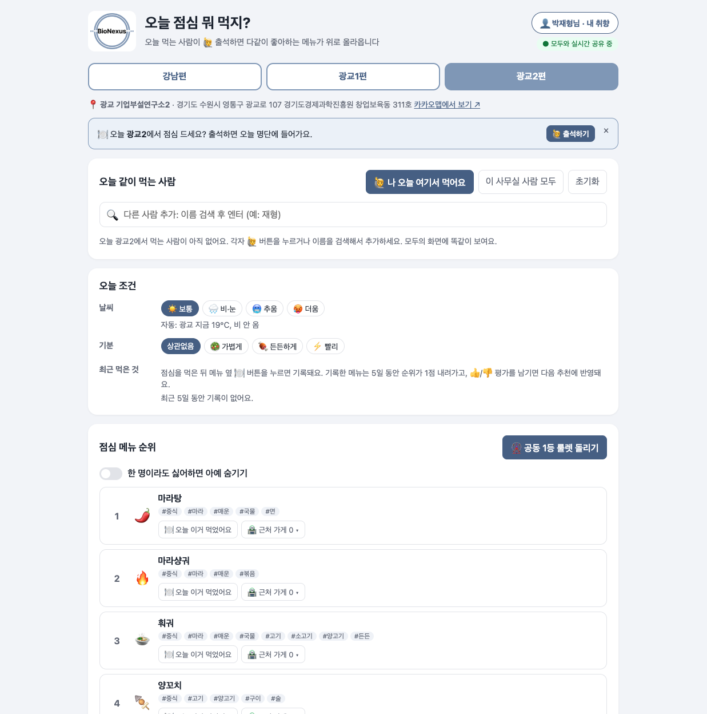

# BioNexus 점심 고르기

오늘 같이 먹는 사람이 🙋 출석하면, 모두의 취향과 날씨·최근 먹은 메뉴를 반영해 점심 메뉴 순위를 보여 주는 웹 페이지입니다.
카카오맵으로 사무실 근처 식당까지 찾아 주고, 기록은 Supabase에 저장돼 회사 분들이 함께 씁니다.

👉 **바로 사용하기: https://andrew010417.github.io/what_lunch_do_you_want/**

제작 · 분석팀 박재형 (Claude Code로 개발)

## 사용 방법
1. **처음 한 번만 가입**: 오른쪽 위 🔑 로그인 / 가입 → 이름(성까지) → 제일 좋아하는 음식(비밀번호) → 주 사무실 → 좋아하는 음식 👍 / 싫어하는 음식 👎 저장
2. **매일 점심 전**: 오늘 먹는 사무실 탭을 고르고 🙋 **나 오늘 여기서 먹어요**
3. 출석한 사람들 취향으로 정해진 **메뉴 순위**를 보고, 1등이 여러 개면 🎡 룰렛
4. 🏪 근처 가게에서 카카오맵으로 식당 찾기
5. 먹고 나서 🍽 **오늘 이거 먹었어요** + 각자 ⭐ 별점 (0.5점 단위, 5점 만점)

## 기능
| 구분 | 내용 |
|---|---|
| 출석 체크 | 각자 버튼을 누르면 그 사무실의 오늘 명단에 들어가고, 모두가 같은 명단·같은 순위를 봄. 다른 사무실에서 누르면 그쪽으로 옮겨짐. 이름 검색으로 다른 사람 추가도 가능 |
| 가입·로그인 | 이름 + 주 사무실 + **제일 좋아하는 음식**(비밀번호). 본인 취향만 언제든 수정 |
| 메뉴 순위 | 좋아하는 사람 1명당 +1, 싫어하는 사람 1명당 -1. 한 명이라도 싫어하면 아예 숨기기 모드 |
| 음식 분류 | 메뉴 49개. 나라 / 고기(돼지·소·닭·양) / 해산물(생선·회·조개·오징어) / 요리 방식 / 맛 / 기타 + 메뉴 이름으로 취향 선택 |
| 날씨·기분 | 비·눈·추위 → 국물 +1, 더위 → 시원한 메뉴 +1 (사무실 위치 자동 조회). 가볍게 / 든든하게 / 빨리 필터 |
| 반복 방지·별점 | 최근 5일 안에 먹은 메뉴 -1. 먹은 뒤 각자 별점(0.5점 단위, 5점 만점) → 평균 4점 이상 메뉴 +1, 2.5점 이하 -1. 가게별 평균 별점도 표시 |
| 근처 가게 | 카카오맵으로 사무실 반경 1km 식당 검색 + 지도 핀(마우스를 올리면 가게 이름) → 우리 가게로 저장 |
| 공동 1등 룰렛 | 점수가 같은 1등 메뉴끼리 돌림판 |
| 안내 | 가입 전이면 가입 안내, 출석 전이면 출석 안내 |
| 사용 통계 | 가입자, 사무실별 최근 7일 쓴 날·평균 인원·먹은 기록 비율, 인기 메뉴, 평가 좋은 가게 |
| 메뉴 추가 요청 | 없는 메뉴를 요청하면 모아서 보여 줌 |

## 사무실
| 탭 | 위치 | 주소 |
|---|---|---|
| 강남편 | 강남 연구소 (기업부설연구소) | 서울특별시 서초구 강남대로 373 13층 |
| 광교1편 | 수원 본사 | 경기도 수원시 영통구 광교로 156 1104호, 광교비즈니스센터 |
| 광교2편 | 광교 기업부설연구소2 | 경기도 수원시 영통구 광교로 107 경기도경제과학진흥원 창업보육동 311호 |

## 저장소
| 위치 | 주소 |
|---|---|
| 웹페이지 (GitHub Pages) | https://andrew010417.github.io/what_lunch_do_you_want/ |
| GitHub | https://github.com/andrew010417/what_lunch_do_you_want |
| 사내 GitLab | https://gitlab.bionexus.co.kr/bionexus-enterprise/edu/onboarding_1th/what_lunch_do_you_want |

## 사용한 기술
- HTML / CSS / JavaScript (빌드 도구 없음)
- Supabase: 가입한 사람, 취향, 출석, 먹은 기록, 가게, 메뉴 요청 저장 + 실시간 반영
- 카카오맵 JavaScript API: 주소 → 좌표, 근처 식당 검색, 지도
- Open-Meteo: 사무실 위치의 현재 날씨

## 파일 구성
| 파일 | 내용 |
|---|---|
| `index.html`, `style.css`, `app.js` | 화면과 동작 |
| `data.js` | 메뉴, 음식 분류, 사무실, 카카오·Supabase 키 |
| `supabase.sql` | Supabase 설정 (표, 보안 규칙, 가입·로그인 함수) |

메뉴나 사무실은 `data.js`에서 고칩니다. 사람은 코드에 적지 않고 각자 페이지에서 가입합니다.

## 관리자 안내

### Supabase 설정
1. https://supabase.com 에서 New project (Region: Northeast Asia (Seoul))
2. SQL Editor → New query → `supabase.sql` 내용을 붙여 넣고 Run (기능이 바뀌면 다시 실행. 여러 번 실행해도 안전)
3. Project Settings → API 에서 **Project URL**과 **publishable(anon) 키**를 `data.js`의 `SUPABASE_URL`, `SUPABASE_ANON_KEY`에 넣기
   - `service_role` / `secret` 키는 절대 넣지 마세요.

### 데이터 보기 (Supabase → Table Editor)
- `lunch_docs`: 모든 기록. `collection` 칸으로 구분 — `people`(가입자), `prefs`(취향), `checkins`(출석), `days`(먹은 기록·평가), `restaurants`(저장한 가게), `requests`(메뉴 요청), `ratings`(별점)
- `lunch_secrets`: 비밀번호. bcrypt로 암호화돼 관리자도 볼 수 없음

### 로그인 관리
- 띄어쓰기와 대소문자는 구분하지 않습니다 ("마 라 탕" = "마라탕"). 5번 틀리면 10분 잠깁니다.
- 비밀번호를 잊은 사람: `lunch_secrets`에서 그 사람 id 줄을 지우면, 다음 로그인 때 새 음식으로 다시 정할 수 있습니다.
- 사람을 지우려면: `lunch_docs`의 그 id `people`·`prefs` 줄과 `lunch_secrets` 줄을 지웁니다.
- 같은 이름으로는 두 번 가입할 수 없습니다.
- 무료 플랜은 오래 접속이 없으면 프로젝트가 일시 정지될 수 있습니다. "공유 저장소 연결 실패"가 뜨면 대시보드에서 다시 켜 주세요.

### 카카오맵 설정
1. https://developers.kakao.com → 내 애플리케이션 → 앱 추가
2. **JavaScript 키**를 `data.js`의 `KAKAO_JS_KEY`에 넣기
3. JavaScript SDK 도메인(또는 플랫폼 → Web 사이트 도메인)에 `https://andrew010417.github.io` 등록
4. 제품 설정 → 카카오맵 사용 설정 ON
